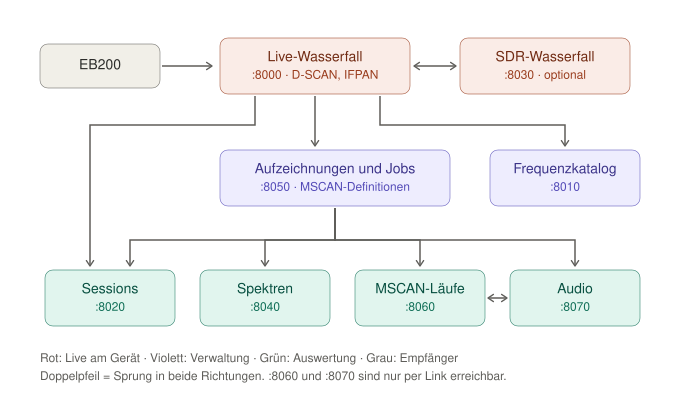

<!-- Status: Entwurf | Quellenstand: 2026-08-29 | offen: - -->

# 2. Was die EB200 Suite ist

## 2.1 Wozu sie gut ist

Der EB200 ist ein hervorragender Empfänger mit einem winzigen Display und
ohne nennenswerten Speicher. Alles, was er misst, ist im Moment der Messung
da und danach weg — es sei denn, ein Rechner hört zu.

Genau das tut die EB200 Suite. Sie gibt dem Gerät:

- einen großen, rollenden Wasserfall im Browser statt eines
  Streichholzschachtel-Displays,
- eine Festplatte: Sweeps, Spektren und Audio werden mitgeschrieben,
- einen Terminkalender: Aufzeichnungen laufen geplant und unbeaufsichtigt
  weiter, auch über Nacht,
- ein Archiv mit Wiedergabe: jede Aufnahme lässt sich später ansehen,
  anhören, vermessen und kommentieren,
- ein Gedächtnis: ein Frequenzkatalog beschriftet, was im Wasserfall zu
  sehen ist.

Bedient wird alles im Browser. Auf dem Rechner selbst läuft nur ein
Konsolenfenster mit dem Starter.

## 2.2 Grundprinzip: mehrere kleine Server

Die Suite ist kein einzelnes großes Programm, sondern eine Handvoll kleiner,
eigenständiger Webserver. Jeder hat eine Aufgabe, einen eigenen Port und eine
eigene Browserseite.

Das hat drei Gründe:

1. **Störungsfreiheit.** Stürzt eine Auswertung ab, läuft die Aufnahme
   weiter. Die Programme wissen nichts voneinander außer den Links, über die
   sie sich gegenseitig aufrufen.
2. **Nachvollziehbarkeit.** Jeder Server ist für sich lesbar und für sich neu
   startbar.
3. **Klare Zuständigkeit für das Gerät.** Nur ein einziger Server spricht mit
   dem EB200. Alle Auswerte-Server lesen ausschließlich von der Platte und
   können den laufenden Empfang nicht stören.

## 2.3 Portübersicht

| Port | Programm | Aufgabe | Einstieg |
|---|---|---|---|
| 8000 | `waterfall.py` | Live-Wasserfall D-SCAN und IFPAN, Mithören, Direktaufnahmen | Startseite |
| 8010 | `eb200_core/block_admin.py` | Frequenzkatalog pflegen | Menü |
| 8020 | `analyze_sessions.py` | Session-Aufnahmen auswerten | Menü oder Aufzeichnungsliste |
| 8030 | `sdr_waterfall.py` | SDR-Wasserfall (optional) | aus dem D-SCAN heraus |
| 8040 | `analyze_spectrum.py` | Spektrum-Aufnahmen auswerten | Menü oder Aufzeichnungsliste |
| 8050 | `manage_jobs.py` | Jobs, Läufe, Aufzeichnungen | Menü |
| 8060 | `analyze_mscan.py` | Ergebnis eines MSCAN-Laufs | nur per Link aus :8050 |
| 8070 | `analyze_audio.py` | Audioaufnahmen auswerten | nur per Link aus :8050 oder :8060 |

Die Server auf 8060 und 8070 haben bewusst keine eigene Dateiliste: Sie
werden immer aus einer Trefferliste heraus geöffnet und erscheinen deshalb
auch nicht im Ansichten-Menü. Rückwege gibt es trotzdem — beide tragen oben
Links zurück in die Aufzeichnungsliste.

Der einzige Server, der mit dem Empfänger spricht, ist `waterfall.py` auf
Port 8000; dort werden auch die geplanten Jobs ausgeführt. Alles andere ist
Verwaltung und Auswertung.

## 2.4 Was die Suite nicht tut

- **Sie ersetzt nicht die Frontplatte.** Das Gerät bleibt vor Ort voll
  bedienbar. Die Suite stellt keine virtuelle Frontplatte nach.
- **Sie vervielfacht den Empfänger nicht.** Es gibt einen Empfänger, also zu
  jedem Zeitpunkt genau eine Betriebsart: entweder D-SCAN oder IFPAN oder
  M-SCAN — nie zwei gleichzeitig. Zwei geplante Jobs mit überlappendem
  Zeitfenster lehnt die Suite deshalb schon bei der Anlage ab.
- **Sie erkennt keine Signale.** Ob eine Aufnahme Sprache, Musik, Telegrafie
  oder Rauschen enthält, entscheiden Sie.
- **Sie ist nicht für das offene Internet gebaut.** Die Server binden auf
  alle Netzwerkschnittstellen und kennen keine Anmeldung. Sie gehören in ein
  vertrauenswürdiges lokales Netz — siehe Kapitel 17.

## 2.5 Woher die Daten kommen

Zwischen PC und Empfänger laufen zwei getrennte Wege:

- **Steuerung:** SCPI-Kommandos über TCP auf Port 5555. Damit werden Bereich,
  Bandbreite, Demodulation, Squelch und Betriebsart gesetzt.
- **Messdaten:** Das Gerät schickt sie von sich aus als UDP-Datagramme an den
  PC — Sweeps, Panorama-Bins, Audio, MSCAN-Treffer. Der PC fordert nichts
  einzeln an; er meldet einmal an, wohin geliefert werden soll, und hört dann
  zu.

Der Server nimmt diese Datagramme entgegen und macht zweierlei damit: Er
schiebt sie an den Browser weiter, wo sie als Wasserfall erscheinen, und er
schreibt sie — wenn eine Aufnahme läuft — auf die Platte. Beides geschieht
unabhängig voneinander: Sie können den Browser schließen, ohne eine laufende
Aufnahme zu beenden.
